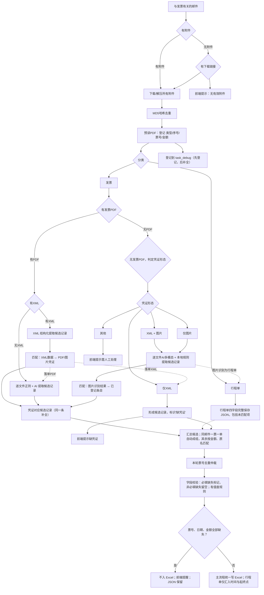
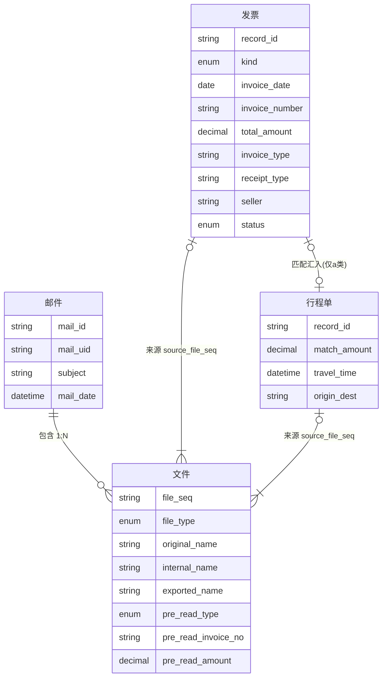
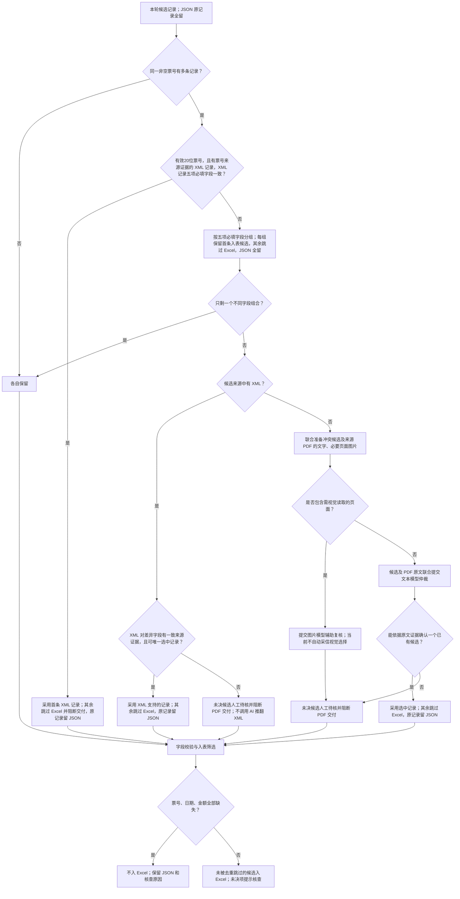

# 发票邮件处理系统 · 重构方案（3.0）

本文是发票邮件处理系统 3.0 的总体重构方案，定义目标、处理流程、数据模型、业务规则、模块接口及验收边界。分工与任务清单见同目录《计划分工.md》。

参与重构前须先阅读本文。**第 3～6 节为冻结契约，不得擅自发明接口；第 7 节的接口名称和签名按该节约束执行。**

阅读时须区分方案要求与后续记录：原计划表达当时的设计意图；文中注明日期的修订、待评估需求及实现状态分别保留其适用语境。后续实现或其他文档发生变化，不自动替换本文原计划。

---

## 1. 目标与范围

系统处理 PDF、XML、图片，以及满足条件时从邮件正文链接取得的文件；统一完成匹配、仲裁、校验和 ZIP 交付。OFD 忽略。产品验收已全部通过，测试预期审核与各次运行结果分别管理，详见第 8 节。

本重构评审锁定以下决策：

- **记录单位**：一张发票对应一笔业务记录。
- **来源粒度**：每条业务记录关联来源邮件和来源文件，形成行级溯源关系。
- **行程单匹配依据**：先比较报销金额，按四舍五入及容差规则形成候选，再以原文件名核对；不以发票号码或销售方自动配对。完整规则见 §4.2。
- **非目标**：不自动标记邮件已读，不做发票真伪查验，不长期保存邮件内容。

---

## 2. 主处理流程

当前完整流程以[独立主流程图](../02%20technical-design/主流程图mermaid.txt)为准；下方内嵌图与该文档保持一致。



### 关键分支与回流
| 分支 | 条件 | 行为 |
|------|------|------|
| B/D | 附件 / 下载链接 | 有非 OFD 附件时处理附件，不检查正文链接；无非 OFD 附件才检查链接；均无可处理文件时提示“无有效附件” |
| F | MD5 去重 | 同邮件内重复只留一份；记 `dedup_skipped`，不展示 |
| G→K | 预读 | 只登记基础字段（类型/序号/票号/金额）；先入任务级"待补全"表 |
| M→N | 有 XML | 以 XML 结构化数据为准形成候选记录 |
| C→F | OFD 文件 | 直接忽略，不提取、不转换、不参与匹配；仅有 OFD 时无可处理文件 |
| M→Q | 无 XML、已有 PDF 发票 | 正则 + AI 提取 |
| S | 无发票 PDF | 判凭证形态：仅 XML / XML+图片 / 仅图片 / 其他 |
| U→Z | 仅 XML | 形成候选记录，**标"缺凭证"** + 前端提示 |
| V/W→X | 含图片 | AI 多模态 + 本地规则校验（口径见 §2.1）|
| T→AB | 其他 | 前端提示需人工处理 |

图中的虚线表示回流关系：图片被识别为行程单后进入 I；匹配后落单的 XML 回到 U；落单的 PDF 回到 Q。

### 2.1 本地规则校验（X 分支的硬性口径）
对 AI 多模态解析结果执行确定性规则检查，按以下条件判别可靠性：
- **发票号码**：必须符合位数/格式规则（20 位数字，已固化），不符合视为不可靠
- **报销金额**：必须为数字且 > 0，与"价税合计(小写)"一致，不带货币符号
- **发票日期**：必须符合 `YYYY-MM-DD`
- **结果处理**：满足规则时采信；不满足时降级至兜底、AI 二次仲裁或人工待核。

> 发票号码位数已固化为 20 位数字（本次评审确认）。

---

## 3. 数据模型与输出契约

### 3.1 实体关系与字段归属（契约）
下图与[独立实体关系图](../02%20technical-design/实体关系图.txt)保持一致。



**a 类判定。** `行程类型ab == "a类"` 表示该发票需要行程单。票面类型以子串方式匹配 `config.py::TRANSPORT_RECEIPT_KEYWORDS`：通行费、客运服务(费)、代收通行费、运输服务费、网约车服务费、出租车服务费，并对“费”字容错。
**旅行字段归属。** 出行时间和出发地目的地从行程单页面提取，匹配成功后汇入 a 类发票记录，再写入 Excel；图中箭头表示这一数据流向。b 类发票不涉及这两个字段。
**编号与字段边界。** 文件编号由 `mail_id` 和文件序号组成，只在本轮唯一。发票保留销售方；行程单仅保留编号、匹配金额、出行时间和起终点，不再提取销售方或承运方。

### 3.2 输出给用户的 Excel 视图
- **统一八列表头**：发票日期、发票号码、报销金额、发票类型、票面类型、出行时间、销售方、出发地/目的地。
- b 类的出行时间、出发地/目的地两列留空；a 类按匹配结果填写旅行两列，不因发票类别改变表头或列数。
- **不输出**：文件序号、来源邮件、邮件时间、文件类型
- **行程单不单独成行**，命中后仅将时间、起终点汇入 a 类发票行；不另建用户表，也不追加在发票表后。
- **入表单位是发票**：仅票号、日期、金额全部缺失时不入 Excel，前端提醒；部分缺失仍入表并标人工待核，JSON 保留记录。
- **内部校验表**：保留现有布局；按行程单字段删除决定去掉相关企业名称字段。

### 3.3 `task_debug.json` 结构（契约基线）
内部 JSON 以邮件为单位组织条目，完整保存所有行程单的四个字段，包括未匹配项。以下示例说明结构；原方案中新增结构待代码适配的要求予以保留：
```
{
  "mail_id": "Msg3",                # 邮件序号（业务）
  "mail_uid": "1747702802",         # IMAP UID（追源）
  "subject": "…",                   # 邮件主题
  "mail_date": "YYYY-MM-DD HH:mm",  # 邮件日期时间（分钟精度）
  "files": [ {
      "file_seq": "01",             # 文件序号
      "file_type": "PDF|XML|图片|其他",
      "original_name": "…",         # 原文件名
      "pre_read_type": "Invoice|Itinerary|Unknown",
      "pre_read_invoice_no": "…",   # 预读票号
      "pre_read_amount": "1264.0"     # 预读金额
  } ],
  "itineraries": [ {                # 全部行程单，包括未匹配项
      "record_id": "Msg3-02",
      "match_amount": "53.93",
      "travel_time": "YYYY-MM-DD HH:mm",
      "origin_dest": "出发地→目的地"
  } ],
  "records": [ {                    # 一笔 = 一条记录
      "record_id": "Msg3-01",
      "kind": "a类|b类",             # 票面类型缺失时暂空，标人工待核
      "fields": { "invoice_date":"YYYY-MM-DD", "invoice_number":"…",
                  "total_amount":"1264.0", "invoice_type":"", "receipt_type":"…",
                  "seller":"…", "travel_time":"…", "origin_dest":"…" },
      "source": { "source_file_seq": ["01"] },
      "matched_itinerary": { "file_seq":"02", "match_amount":"53.93" },
      "status": "complete|缺凭证|人工待核"
  } ],
  "dedup_skipped": [ { "filename":"…", "reason":"…" } ],
  "error_reason": ""
}
```

### 3.4 `file_classifications` 契约（AI 返回）
- 逐文件提取：一次调用输入一个文件，数组长度为 1，仅对应本次输入；匹配由程序完成。
- 每项：`{"file": "<本次输入的内部文件名（含实际扩展名）>", "role": "Invoice|Itinerary|Unknown"}`。T2 输入仅 PDF；T3 的 XML/图片按同一单文件身份约束扩展，不强制伪装成 `.pdf`。

---

## 4. 匹配与去重仲裁

### 4.1 数据文档 ↔ 凭证匹配（O / Y）
本项属于 T3 单列任务。T2 主循环只预留接入位置；以下是后续目标规则，不计入 T2 验收。

- 数据侧为 XML 或图片识别结果，凭证侧为 PDF／图片发票，两侧按发票号码建立对应关系。
- 无法识别时，使用预读或本地规则锚点继续处理。

### 4.2 行程单匹配（仅 a 类发票需要）
1. **判断数量例外。** 同一邮件初始或移除已确认配对后恰好单发票 + 单行程单 → 直接成组，不要求金额完整、一致或原名对应；数量按剩余全部记录计算，不因过滤 b 类、未知类别、异常来源或待核项触发。仅来源有效的 a 类建立关联并汇入旅行字段，仍须遵守字段校验与入表条件。
2. **形成金额候选。** 其他数量组合（如二对一、二对二、三对二）按优先级匹配：① 报销金额 → ② 原文件名。先比较金额精度，将精度较高者按精度较低者的小数位数四舍五入；若仍不相等，再比较**原始金额**差值，绝对值 ≤0.5 可列为金额候选。
3. **原名消歧与一对一冲突裁决。** 当前金额层不唯一时用原文件名在该层继续核对；两金额层均无候选时允许明确原名尾缀兜底。逐张发票形成拟关联后统一检查一对一冲突：同一行程单拟关联多票时，仅一票有明确对应尾缀则优先确认它，其余发票进入下一轮；无或多票明确对应则冲突相关记录人工待核，停止其自动匹配，独立关系继续。
4. **确认关系并逐轮重算。** 统一确认成功关系 → 汇入 出行时间 / 出发地目的地 到 a 类发票行；仅从工作候选移除确认配对，保留原始列表，再从数量判断开始下一轮。没有新增配对时停止并标记未解决项；本次中间歧义不提前写入待核。销售方不参与自动配对，不按最近金额或顺序猜测。

**规则沿革：2026-10-04 金额与名称细化。** 以下细化规则继续保留：相等层优先，无相等候选才用原始差值≤0.5；该层多项按非空尾缀消歧；无金额候选也允许明确尾缀兜底。“行程单A↔发票A”“行程单B↔发票B”可对应，A/C不对应；尾缀从原名角色词后提取并归一化后完全比较。

**规则沿革：2026-10-09 批准修订。** 发票为主记录、行程单为补充附件；一对一冲突由唯一明确尾缀优先解决，确认配对后逐轮重算，最后剩余一票一单自动成组。此修订覆盖此前“冲突一律全部撤回”和“仅按初始数量判断单对单”的部分。接口和数据模型不变，已有待核原因、来源及全部行程单保留。具体规则、流程图、研发证据及交接见 `02 build/T2-3/`。

**金额计算与显示。** 使用十进制（Decimal）计算，保留最多四位小数的原始精度，不提前统一舍入两位；仅最终 Excel 显示两位。

> 金额边界测试覆盖差值 0.49、0.50、0.51；0.50 属于容差内。金额相近不等于可直接自动配对，最终须唯一确定。

### 4.3 写 Excel 前去重仲裁（本轮结果集**内部**，不跨历史文件）

- **人工待核（K）**：记录的 `status` 标记为“人工待核”，仍进入 Excel；票号、日期、金额全部缺失的记录除外。前端提供邮件名、时间和文件序号，引导用户回邮箱核对。
- 本轮去重与仲裁已接入 XML 来源优先分支；候选及冲突证据留在 JSON。

---

## 5. 来源定位、文件命名与交付（契约）

- **本轮唯一定位键**：`Msg{序号}-{文件序号}`，如 `Msg3-02`
- **邮件标识** `Msg{序号}`：本轮未读邮件按序编号；内部**缓存 IMAP UID** 保证追源稳定
- **文件序号** `01/02/03…`：该邮件下所有参与处理的文件统一编号（PDF直附件、ZIP内PDF、XML、图片使用同一套，邮件内唯一），**与邮件双向可查**
- **内部存盘名**：`Msg{序号}_{文件序号}_{安全名}`，同名不覆盖；内容相同时只保留首份
- **规则：任何"文件序号"必须能反查到具体邮件 + 文件，不得只有序号无关联**

### 5.1 用户交付及业务命名

- **用户压缩包命名与范围**：交付包仅含汇总表、`task_debug.json` 和业务名发票/行程单 PDF；XML/图片及内部目录不直接交付；OFD 忽略。业务名按 PRD US-8，内部名与交付名分离。已匹配的一组票据中，发票和行程单导出名均取关联行程单的首笔出行日期与该发票的 `fields.total_amount`；未匹配发票取自身 `invoice_date`、`total_amount`，未匹配行程单取自身 `travel_time`、`match_amount`。开票日期、出行时间及两种原始金额各自保留在 JSON，不因导出名改变匹配与校验；仅 XML 无票面凭证时保留记录并提示缺凭证，不虚构 PDF。
- **原名与安全名**：完整 MIME 解码原名保留在 JSON，用于匹配和追源；清理非法字符、空名等只作用于存盘名。实际完整文件名最多 120 字符（含编号、扩展名及重名后缀），超长主体截断加短摘要，保留扩展名。

### 5.2 跨轮隔离

编号只在本轮唯一。本机和云端运行均采用每轮独立的临时工作目录，通过 ZIP 下载结果；不新增跨轮编号机制，也不提供本机桌面输出模式。

---

## 6. 字段校验（按凭证类型差异化）

字段定义与校验口径见[字段表](../02%20technical-design/字段表.txt)。

字段校验按字段归属划定范围，解决旧代码把 b 类发票误报为缺少出行时间或出发地的问题。不同凭证使用各自的校验范围，不共用一份全字段清单。

- `b类发票`：只校验 6 字段（日期/号码/金额/发票类型/票面类型/销售方），**不查** 出行时间/出发地
- `a类发票`：校验 8 字段，其中 出行时间/出发地目的地 **校验"是否已从行程单汇入"**，不是"发票自身是否有"
- `行程单`：仅保留并校验 编号/匹配金额/出行时间/出发地目的地。
- **必填/非必填**：发票类型非必填，缺失留空、有值查规则；票面类型必填，用于判断 a/b，缺失标缺失、人工待核，不默认 b 类。其余必填字段同样缺失标记、有值查规则。上文 6/8 字段为校验范围，不代表全部必填。
- **票面类型校验边界**：按现有提取结果清理星号及分类简称，检查文字类型、缺失和长度，再按交通关键词判定 a/b；不要求命中有效值清单，不新增 PDF 票面位置核验。通过这些检查仅表示满足本项目字段格式与分类规则，不证明发票真实性。

### 6.1 原方案的旧代码调整要求

以下三处为原方案要求的改动点：
1. `build_fallback_audit_result`：删除发票侧提取出行时间和出发地目的地的逻辑。
2. `_collect_not_found_alerts`：只对 a 类发票检查旅行字段是否已经汇入。
3. `SUMMARY_COLUMNS`：a 类的出行时间、出发地/目的地须在行程单匹配后汇入，再写入汇总列。

---

## 7. 模块接口契约（冻结）

新版主流程为 `pipeline.py`，根目录旧 `invoice_pipeline.py` 已移除。模块边界按实际调用关系理解，不固定调用链的文件数量。

各任务只实现自己的模块，导入已冻结接口；不得擅自修改下表约定的接口名称或签名。

| 目标模块 | 对外接口（签名冻结） | 类别 |
|---------|---------------------|------|
| `config.py` | `RunConfig`(dataclass)；`safe_desktop_subfolder`；`_imap_error_hint`；`should_send_netease_id`；`ensure_output_dirs`；常量 `SUMMARY_COLUMNS`、`TRANSPORT_RECEIPT_KEYWORDS` | A |
| `utils.py` | `build_non_conflicting_path`；`format_amount_text`；`clean_receipt_type`；`format_travel_date_cn`；`format_invoice_date_cn`；`_normalize_date_text`；`clean_filename`；`decode_str`；`safe_parse_mail_date`；`sanitize_excel_date_display`；`zip_directory_to_bytes` | A |
| `type_classifier.py` | `classify_type_from_attachment_name`；`normalize_doc_role`；`_resolve_ai_role_for_file`；`collect_classification_mismatches` | B（T2 重写） |
| `fallback_extractor.py` | `build_fallback_audit_result` | A（微调，见§6-1） |
| `ai_client.py` | `call_ai_audit_and_rename`；`_rename_pdfs_with_audit`；提示词外置在根目录 prompts.txt，由 prompt_loader.py 读取 | A |
| `excel_writer.py` | `append_to_summary_excel` | A |
| `attachment_processor.py` | 公共附件获取、ZIP 解压、MD5 去重、安全存盘、文件序号与格式登记；留下载链接获取接口 | B/C |
| `pipeline.py` | `run_pipeline(cfg, log)->(mismatches, stats)`（T2-1 主流程调度与记录组装） | C |

T2 的 PDF 提取、行程单匹配、去重仲裁、字段校验可从旧实现复制并改造为独立模块；T3 的 XML/图片提取及跨格式凭证匹配各有独立任务。建议文件名、调用边界与 Excel/来源链见《项目结构与任务边界.md》，模块内部新接口由对应任务提出并核对。旧版快照不修改。

**类别说明**：
- **A：原样迁移。** 只调整 import 路径，不改业务逻辑，适合交给独立开发对话实施。
- **B：微调适配。** 调整数据形态或落盘名，不改变量逻辑。
- **C：逻辑重写。** 涉及颠覆性逻辑变更，由原方案负责对话把关。

---

## 8. 实现记录、验收边界与后续事项

### 8.1 实现与验收记录

产品验收已全部通过。当前主流程支持 PDF、XML、图片，按附件/链接分流后执行同票组合、行程单匹配、同轮去重仲裁、字段校验、Excel/JSON 和精简 ZIP 交付。提示词位于根目录 prompts.txt。OFD 忽略；ofd_processor.py 为测试引用暂保留，生产主流程不调用。

18 条必选虚构用例原有预期已人工审核，逐字段扩展草案仍待人工审核。研发自测、独立受控测试和真实服务调用按各自原始报告记录；产品验收通过不改变这些结果。多张发票共用一份多笔行程单属于范围外待评估需求，不能从本次验收通过推断已支持。

### 8.2 待评估需求与已接受限制

**待评估需求（2026-10-30）：多张发票共用一份多笔行程单。** 当前 T2-3 只支持发票与行程单一对一匹配，不会将一份行程单中的多笔明细拆分给多张发票，也不能仅依据多张发票金额之和等于行程单总额确认关系。比如两张发票分别为 102.39 元、55.41 元，行程单共 157.80 元且包含多笔行程，目前不支持自动确认两票共用该行程单；程序会保留原记录与行程单并提示人工核对。该需求未开发、未验收，暂不调整现有主流程图和一对一规则。后续如需支持，应先确认明细对应依据、组合不唯一的处理、同一明细是否可重复使用、Excel 中多笔时间与起终点的展示、行程单命名及交付方式，再制定开发和测试方案；金额合计相等本身不证明业务归属。

**已知限制：附件名称与实际内容不符。** 用户在附件名称含“发票”、实际内容与发票无关的测试邮件中反馈过程序报错。附件名称只是角色判断线索，不能证明内容属于发票；系统应结合内容判断，无法确认时交由人工核对。产品负责人决定暂不修复此场景，作为已知限制保留。具体报错原因和影响范围未进一步复核，不据此断言程序仅凭名称认定发票，也不将该项写为已修复。产品验收已全部通过，包含对此限制的接受。
