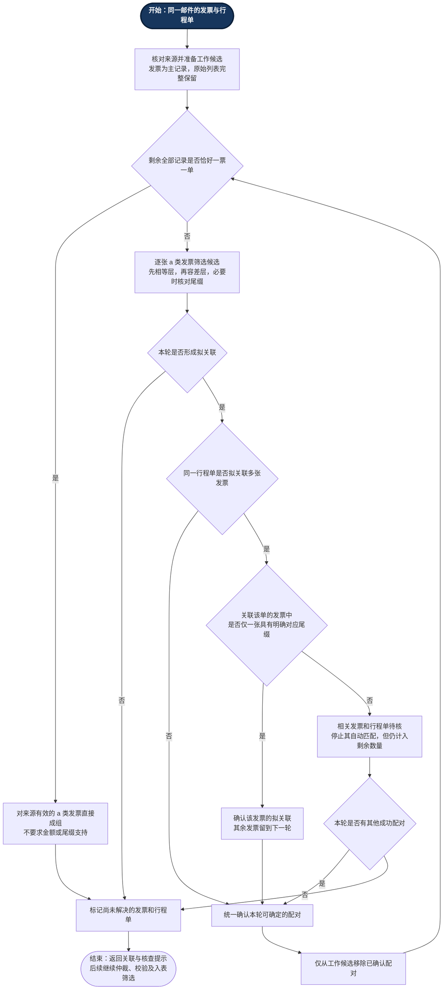

# T2-3 修订计划与实施核对

日期：2026-10-09。状态：批准后研发实现、自测及相关回归完成；独立验收与真实附件验证待执行。

## 1. 批准依据与目标

项目负责人确认“最后只剩一票一单自动成组”，并在两张发票均100、行程单A为100、另一单为200的例子中选择“明确尾缀优先”。随后审核了《T2-3 修订计划：逐轮匹配与末尾单对单》，要求以发票为核心准确表述冲突、按流程顺序画图，最后明确授权：“计划批准，可以开工”。此前规则答复不单独视为实施授权。

本次目标：为每张 a 类发票寻找对应附件并汇入旅行字段；逐轮确认配对；一对一冲突有唯一明确尾缀对应者时优先关联该发票；移除确认配对后，最后剩余一票一单自动成组，包括金额不同、缺失和空尾缀。

## 2. 按执行顺序的流程图

起点为深色“开始”，主流程自上而下；循环只回到本轮数量判断。

来源校验失败及 b 类/未知类别不建立关系；图中的“直接成组”也须满足此条件。数量始终包含尚未确认的全部记录，不因这些项被过滤而触发单对单。已确认关系不在后续轮次重新分配。

## 3. 决策与实现核对

| 批准要求 | 实现与验证 |
|---|---|
| 发票为主记录，行程单补充信息 | 每轮逐张发票生成拟关联；仅 a 类更新 matched_itinerary 和旅行字段；行程单不独立入表 |
| Decimal 精度、相等层优先、原始差值≤0.5 | 保留原 _amount_level，原始金额不改；相等层不唯一时不跳到容差层 |
| 非空原名尾缀完全对应 | 保留 _name_suffix：原名去扩展名、角色词后尾缀、NFKC/casefold、边缘分隔符清理 |
| 唯一明确尾缀优先解决重复关联 | 全部拟关联生成后分组检查；组中仅一张尾缀对应时确认它，其他发票下一轮重新筛选 |
| 没有或多张明确对应则人工待核 | 冲突相关发票和行程单停止自动匹配；其他独立关系继续；待核记录仍计数 |
| 确认配对后重新计算，末尾一票一单自动成组 | 仅扣除已确认配对数量；工作候选排除已确认附件，原始 records/itineraries 不删除 |
| 无进展停止，不按顺序或最近金额猜测 | 每轮统一筛选、裁决和确认；无新增配对结束；三轮链及重排结果验证通过 |
| 不保留本次中间歧义误报 | 未命中/不唯一原因每轮暂存，结束后才写入；不可解决冲突即时待核；已有原因不清除 |
| 不新增接口/字段，不改后续流程 | 沿用 match_itineraries(mail, itineraries) -> list[dict]；现有自动加载端口，无调度/模型修改 |
| 原金额、来源、待核、全部行程单保留 | 多轮 JSON、原始精度、发票 source_file_seq、字段缺失和重复调用研发验证通过 |

本次只修改根目录匹配器、T2-3 研发测试与过程资料，以及正式设计/进度的相关段落。T1、其他根目录模块、T2-1/T2-2 自测及测试工程师资料均未修改。

## 4. 用例与结果

| 情况 | 结果 |
|---|---|
| 发票A、发票、行程单A、行程单，均100 | A↔A；剩余匿名两份成组；没有中间歧义待核 |
| 两票均100，单A100、匿名单200 | A凭唯一明确尾缀优先关联；匿名票↔匿名单200；发票金额仍100 |
| 匿名票先无证据，另一张有确定关系 | 先确认另一张；末尾匿名一票一单成组 |
| 末尾金额缺失/非法/超精度 | 关系建立，原值保留，金额问题继续待核 |
| 甲发票A、乙发票A同时拟关联单A | 多张均明确对应，相关关系待核，不选赢家 |
| 两张空尾缀发票拟关联空尾缀单 | 空尾缀不算证据，冲突待核 |
| 三轮金额候选逐步缩小 | 连续确认三组；不写入中间歧义 |
| 一组确认后剩余两票两单仍无唯一关系 | 仅第一组成功，其余人工待核 |
| 普通/未知类别、异常来源、冻结冲突项被过滤 | 仍计数，不能制造末尾单对单 |

T2-3 引擎38项、集成12项，共50/50；T2-1研发回归10/10；T2-2研发回归7/7，合计67/67。包括实际端口、主流程 JSON 关联、八列 Excel、后续仲裁校验以及全部行程单持久化。

原始结果在 `result/revision_20261009/`。运行器 `run_dev_validation.py` 只执行以上研发测试。第一次运行的临时目录权限错误保留在 `attempt_01/`，随后将临时目录限定在本阶段 result 下重跑全部通过，没有为此修改业务模块。

与开工快照比较，290个受保护文件的 SHA256 和修改时间一致；包括 `03 tests/` 全部文件、其他根目录模块、T2-1/T2-2 研发脚本及固定用例范围文档。开工前原匹配器/文档/用例副本在 `baseline/revision_20261009/`。

## 5. 资料交接与完成边界

当前规则见《T2-3_匹配规则确认.md》，结果见 `result/latest.md`，交接见《T2-3_研发交接.md》。2026-10-04 的分析、授权与结果保留为历史记录，由本次批准规则覆盖数量例外和冲突裁决部分。

正式《重构方案》§4.2和《计划分工》同步新规则及研发状态；固定用例范围文档仍将 C20/C21 列为 T3 可选，差异交接给测试方，本阶段不修改其资料或运行独立验收。真实附件、真实邮箱/模型提取效果及独立验收尚未验证。
